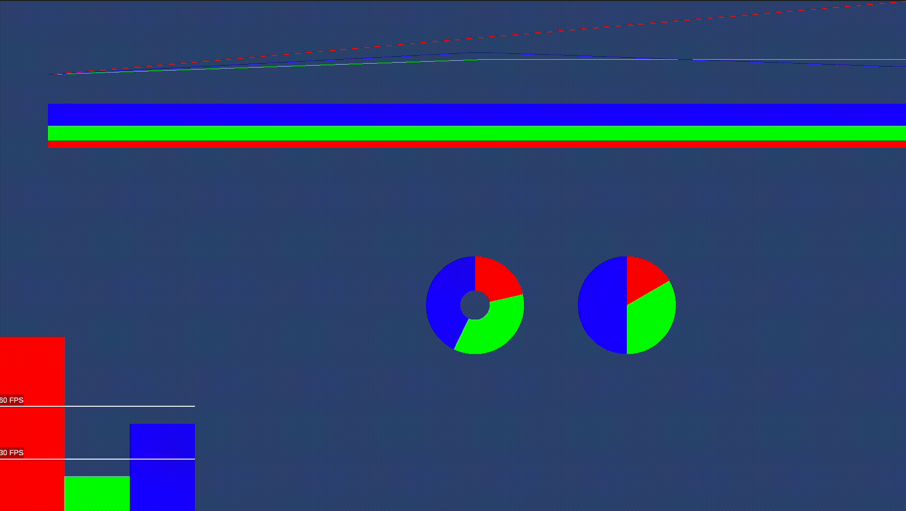
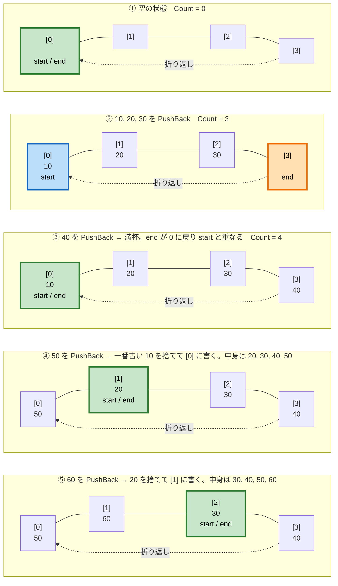
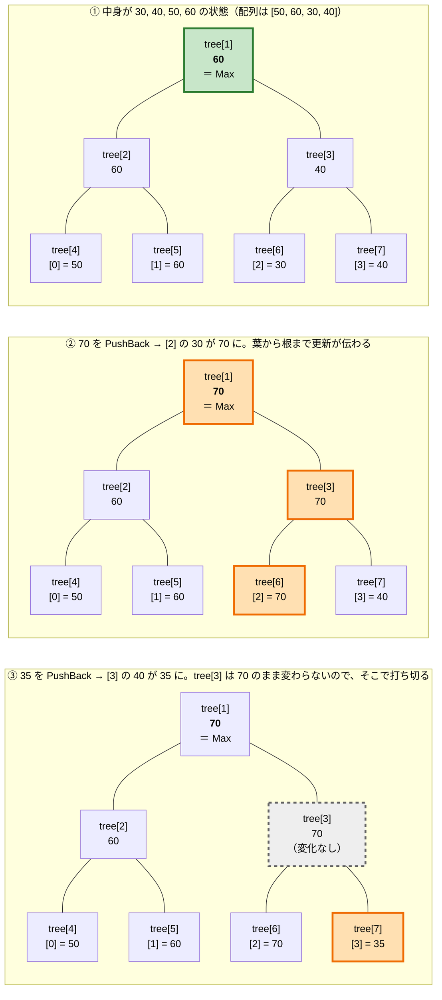

# XGraphs

[English](README_EN.md)



Unity の uGUI 上で棒グラフ・折れ線グラフ・円グラフなどを描画するためのパッケージです。系列データのモデルとデータソース用アダプタ、インスペクタ拡張を備えており、ランタイムでもエディタでもグラフを素早く構築できます。

このリポジトリは Unity プロジェクトになっており、パッケージ本体は [`Packages/jp.xeon.x-graphs/`](Packages/jp.xeon.x-graphs/) にあります。サンプルシーンもあわせて確認できます。

## 主な特徴
- 棒グラフ、積み上げ棒グラフ、折れ線グラフ、円グラフ、リンググラフ、レーダーチャートを uGUI コンポーネントとして提供します。
- `Series` / `MultiValueSeries` などのデータモデルで、複数凡例・複数系列を扱えます。
- 配列、`List<T>`、`ObservableCollection<T>`、`CircularBuffer<T>` をアダプタ経由でそのままデータソースにできます。
- 棒グラフ・積み上げ棒グラフ・折れ線グラフには、任意の値にラベル付きの目盛り線（マーカー）を表示できます。
- **GameObject > UI > XGraphs** メニューから各グラフを Canvas 上に作成できます。

## 動作環境
- Unity 6000.0 以降
- uGUI（`com.unity.ugui`）
- TextMeshPro（凡例とマーカーのラベル表示に使用）

## インストール
Unity の **Window > Package Manager** で `+` メニューから **Install package from git URL...** を選び、次の URL を入力します。

```
https://github.com/AraiYuhki/XGraphs.git?path=/Packages/jp.xeon.x-graphs
```

`Packages/manifest.json` に直接追記する場合は次のとおりです。

```json
{
  "dependencies": {
    "jp.xeon.x-graphs": "https://github.com/AraiYuhki/XGraphs.git?path=/Packages/jp.xeon.x-graphs"
  }
}
```

## サンプル
1. リポジトリをクローンします。
   ```
   git clone https://github.com/AraiYuhki/XGraphs.git
   ```
2. Unity Hub の **Add > Add project from disk** でクローンしたフォルダを開きます。開発に使用している Unity のバージョンは `ProjectSettings/ProjectVersion.txt` で確認できます。
3. `Assets/Scenes/SampleScene.unity` を開いて Play します。

[`Assets/Scripts/GraphSample.cs`](Assets/Scripts/GraphSample.cs) がフレーム時間（Update / Render / その他）とログ件数をリアルタイムに集計し、折れ線グラフ・積み上げ棒グラフ・棒グラフ・円グラフ・リンググラフで表示します。折れ線グラフと積み上げ棒グラフには FPS の目安線（15 / 30 / 60 / 90 / 120 FPS）がマーカーとして表示されます。

## クイックスタート
1. **GameObject > UI > XGraphs > Bar Chart** で Canvas 上に棒グラフを作成します。
2. スクリプトから `MultiValueSeries` を組み立てて `Initialize` に渡します。

```csharp
using System.Collections.Generic;
using UnityEngine;
using Xeon.Common;
using Xeon.XGraph.Model;
using Xeon.XGraph.View;

public class BarChartSample : MonoBehaviour
{
    [SerializeField] private BarChart chart;

    private void Start()
    {
        var sales = new Series("売上", Color.cyan, new[] { 80f, 120f, 100f });
        var profit = new Series("利益", Color.green, new[] { 40f, 60f, 55f });
        var series = new MultiValueSeries(new List<Series> { sales, profit }, Color.white);

        var markers = new List<ScaleMarkerData> { new("目標", 100f) };
        chart.Initialize(series, markers);
        chart.SetMax(150f);
    }
}
```

値を追加するときは `Series.Add` または `MultiValueSeries.AddValue` を使うと、グラフが自動で再描画されます。リアルタイムに値を流す場合は、`CircularBuffer<float>` を渡して `Series` を作ると古い値から順に捨てられます（`GraphSample.cs` を参照）。

## 収録コンポーネント
| コンポーネント | データ | 概要 |
| --- | --- | --- |
| `BarChart` | `MultiValueSeries` | 複数凡例の棒グラフ。値域・棒の間隔・マーカーを設定できます。 |
| `StackedBarChart` | `MultiValueSeries` | 凡例ごとに値を積み上げる棒グラフ。 |
| `LineChart` | `MultiValueSeries` | 複数系列の折れ線グラフ。線幅とマイター結合の上限を設定できます。 |
| `PieChart` | `MultiLegendSeries` | 円グラフ。開始角度を設定できます。 |
| `RingChart` | `LayeredSeries` | `MultiLegendSeries` を層として重ねるリンググラフ。 |
| `RaderChart` | `MultiValueSeries` | 複数凡例のレーダーチャート。開始角度と最大値を設定できます。 |

## データモデル
| クラス | 用途 |
| --- | --- |
| `Series` | 1 凡例分の連続データ。配列・`List<T>`・`ObservableCollection<T>`・`CircularBuffer<T>` をラップします。 |
| `MultiValueSeries` | 複数の `Series` を束ねたデータ。棒・積み上げ棒・折れ線・レーダーで使います。 |
| `SingleValueSeries` | 名前・色・単一値を持つ凡例。 |
| `MultiLegendSeries` | 複数の `SingleValueSeries` を束ねたデータ。円グラフで使います。 |
| `LayeredSeries` | 複数の `MultiLegendSeries` を層として束ねたデータ。リンググラフで使います。 |

詳しい使い方はパッケージの [README](Packages/jp.xeon.x-graphs/README.md) を参照してください。

## CircularBuffer の仕組み
リアルタイムのグラフでは「直近 N 件だけを表示し、古い値から捨てていく」処理を毎フレーム行います。`CircularBuffer<T>` はそのためのリングバッファで、固定長の配列と、先頭位置 `start`・次の書き込み位置 `end` の 2 つのインデックスだけで動きます。

- 末尾への追加、先頭の破棄、i 番目の読み取りはすべて O(1) です。要素をずらす処理はありません。
- 配列は最初に一度確保したきりなので、毎フレーム値を追加しても GC アロケーションが発生しません。
- 満杯になってからは `start` と `end` が重なったまま配列の上を進み、末尾まで来ると先頭に戻ります。値は一度書いた位置から動きません。

容量 4 のバッファに値を追加していくと、次のように動きます。



### DoubleCircularBuffer の最大値管理
`DoubleCircularBuffer` は、バッファ内の最大値を固定長のセグメント木で管理します。縦軸を最大値に合わせて自動調整するときに使います。

- 葉が配列の各位置、根 `tree[1]` が全体の最大値です。`Max` は根を読むだけなので O(1) です。
- 値を書き換えると、葉から根に向かって O(log n) で更新します。親の値が変わらなければ、そこで打ち切ります。
- 木は長さ「容量 × 2」の `double[]` 1 本だけなので、値を出し入れしてもアロケーションが発生しません。

オレンジは書き換わった箇所、灰色の点線は更新を打ち切った箇所です。



## リポジトリ構成
```
Assets/                      サンプルシーン・サンプルスクリプト・プレハブ
Packages/jp.xeon.x-graphs/   パッケージ本体（Runtime / Editor）
ProjectSettings/             Unity プロジェクト設定
```

## ライセンス
ライセンスについてはリポジトリの管理者にお問い合わせください。
