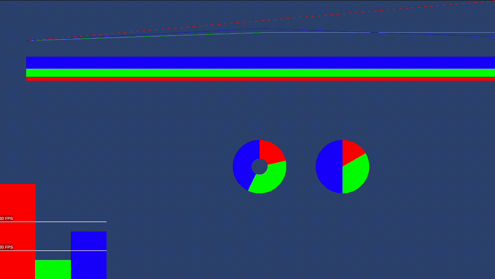
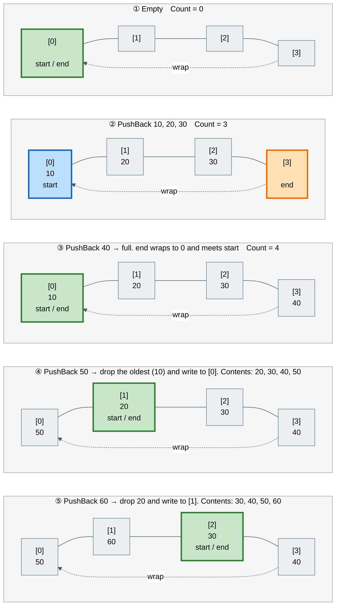
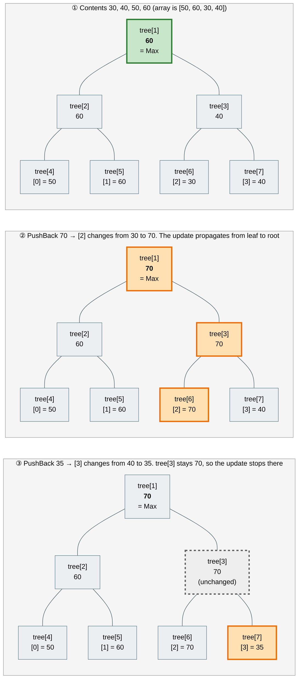

# XGraphs

[日本語](README.md)



A Unity package for drawing bar, line, pie, and other charts on uGUI. It provides data-series models, adapters for common data sources, and inspector tooling so you can build charts quickly both at runtime and in the editor.

This repository is a Unity project. The package itself lives in [`Packages/jp.xeon.x-graphs/`](Packages/jp.xeon.x-graphs/), alongside a sample scene.

## Features
- Bar, stacked bar, line, pie, ring, and radar charts as uGUI components.
- Data models such as `Series` and `MultiValueSeries` handle multiple legends and series.
- Arrays, `List<T>`, `ObservableCollection<T>`, and `CircularBuffer<T>` can be used directly as data sources through adapters.
- Bar, stacked bar, and line charts can show labeled scale lines (markers) at arbitrary values.
- Create any chart on a Canvas from the **GameObject > UI > XGraphs** menu.

## Requirements
- Unity 6000.0 or newer
- uGUI (`com.unity.ugui`)
- TextMeshPro (used for legend and marker labels)

## Installation
In Unity, open **Window > Package Manager**, choose **Install package from git URL...** from the `+` menu, and enter:

```
https://github.com/AraiYuhki/XGraphs.git?path=/Packages/jp.xeon.x-graphs
```

Or add it to `Packages/manifest.json` directly:

```json
{
  "dependencies": {
    "jp.xeon.x-graphs": "https://github.com/AraiYuhki/XGraphs.git?path=/Packages/jp.xeon.x-graphs"
  }
}
```

## Sample
1. Clone the repository.
   ```
   git clone https://github.com/AraiYuhki/XGraphs.git
   ```
2. In Unity Hub, choose **Add > Add project from disk** and open the cloned folder. The Unity version used for development is listed in `ProjectSettings/ProjectVersion.txt`.
3. Open `Assets/Scenes/SampleScene.unity` and press Play.

[`Assets/Scripts/GraphSample.cs`](Assets/Scripts/GraphSample.cs) measures frame times (update / render / other) and log counts in real time and shows them as line, stacked bar, bar, pie, and ring charts. The line and stacked bar charts show FPS guide lines (15 / 30 / 60 / 90 / 120 FPS) as markers.

## Quick Start
1. Create a bar chart on a Canvas with **GameObject > UI > XGraphs > Bar Chart**.
2. Build a `MultiValueSeries` in a script and pass it to `Initialize`.

```csharp
using System.Collections.Generic;
using UnityEngine;
using Xeon.Common;
using Xeon.XGraph.Model;
using Xeon.XGraph.View;

public class BarChartSample : MonoBehaviour
{
    [SerializeField] private BarChart chart;

    private void Start()
    {
        var sales = new Series("Sales", Color.cyan, new[] { 80f, 120f, 100f });
        var profit = new Series("Profit", Color.green, new[] { 40f, 60f, 55f });
        var series = new MultiValueSeries(new List<Series> { sales, profit }, Color.white);

        var markers = new List<ScaleMarkerData> { new("Target", 100f) };
        chart.Initialize(series, markers);
        chart.SetMax(150f);
    }
}
```

Add values with `Series.Add` or `MultiValueSeries.AddValue` and the chart redraws automatically. For real-time data, create the `Series` from a `CircularBuffer<float>` so the oldest values are dropped first (see `GraphSample.cs`).

## Components
| Component | Data | Description |
| --- | --- | --- |
| `BarChart` | `MultiValueSeries` | Multi-legend bar chart with configurable range, bar spacing, and markers. |
| `StackedBarChart` | `MultiValueSeries` | Bar chart that stacks values per legend. |
| `LineChart` | `MultiValueSeries` | Multi-series line chart with configurable thickness and miter limit. |
| `PieChart` | `MultiLegendSeries` | Pie chart with a configurable start angle. |
| `RingChart` | `LayeredSeries` | Ring chart that stacks `MultiLegendSeries` as layers. |
| `RaderChart` | `MultiValueSeries` | Multi-legend radar chart with a configurable start angle and maximum value. |

## Data Models
| Class | Purpose |
| --- | --- |
| `Series` | Sequential data for one legend. Wraps arrays, `List<T>`, `ObservableCollection<T>`, or `CircularBuffer<T>`. |
| `MultiValueSeries` | A set of `Series`. Used by bar, stacked bar, line, and radar charts. |
| `SingleValueSeries` | A legend with a name, a color, and a single value. |
| `MultiLegendSeries` | A set of `SingleValueSeries`. Used by pie charts. |
| `LayeredSeries` | A set of `MultiLegendSeries` as layers. Used by ring charts. |

See the package [README](Packages/jp.xeon.x-graphs/README_EN.md) for more details.

## How CircularBuffer Works
Real-time charts show only the latest N values and drop the oldest ones every frame. `CircularBuffer<T>` is a ring buffer built for this. It uses a fixed-size array and just two indices: `start` (the first element) and `end` (the next write position).

- Appending, dropping the oldest value, and reading the i-th value are all O(1). Elements are never shifted.
- The array is allocated once, so adding values every frame causes no GC allocations.
- Once the buffer is full, `start` and `end` move together across the array and wrap back to the beginning. Values never move once written.

Adding values to a buffer with capacity 4 works like this:



### How DoubleCircularBuffer Tracks the Maximum
`DoubleCircularBuffer` tracks the maximum value with a fixed-size segment tree. It is useful for scaling the vertical axis to the current maximum.

- Each leaf is a position in the array, and the root `tree[1]` holds the overall maximum. Reading `Max` just reads the root, so it is O(1).
- Writing a value updates the tree from the leaf toward the root in O(log n). If a parent's value does not change, the update stops there.
- The tree is a single `double[]` of length capacity × 2, so adding and removing values causes no allocations.

Orange marks the nodes that were rewritten, and the gray dashed border marks where the update stopped.



## Repository Layout
```
Assets/                      Sample scene, sample scripts, and prefabs
Packages/jp.xeon.x-graphs/   The package (Runtime / Editor)
ProjectSettings/             Unity project settings
```

## License
Please contact the repository maintainer regarding the license.
